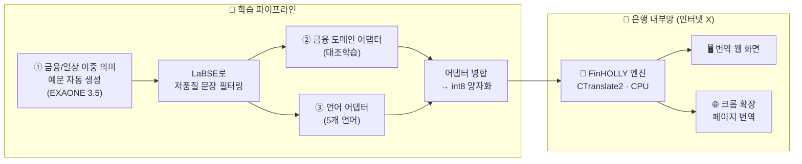

<div align="center">

### 🏦 아이엠뱅크 AI & 블록체인 공모전 출품작

**한국어 금융 문서를 동남아 5개 언어로, 은행 내부망 안에서만 번역합니다.**

🇻🇳 베트남어 · 🇮🇩 인도네시아어 · 🇹🇭 태국어 · 🇵🇭 필리핀어 · 🇲🇲 미얀마어

<br/>


<br/>


</div>

<br/>

## 🚨 풀고 싶었던 문제

> 은행 창구에 오는 외국인 고객에게 금융 서류를 번역해 주고 싶다.
> 그런데 **고객의 개인정보와 거래정보가 담긴 문서를 외부 번역 API로 보낼 수는 없다.**

게다가 일반 번역기는 금융 용어를 자주 틀립니다.

| 한국어 | 금융 맥락의 뜻 | 일반 번역기가 자주 하는 실수 |
|:-:|---|---|
| **청산** | 계약·포지션을 정리하고 결제함 | 빚이나 관계를 "깨끗이 정리함" |
| **모집** | 투자자에게 증권을 공모함 | 사람을 "뽑음", "모음" |
| **사모** | 소수 투자자 대상 비공개 발행 | "그리워함(思慕)"으로 오역 |

**FinHOLLY**는 이 두 문제, 즉 **보안**과 **금융 용어 정확도**를 동시에 해결합니다.

<br/>

## 🏆 FinHOLLY의 강점

<table>
<tr>
<td width="50%" valign="top">

### 🔒 1. 데이터가 밖으로 나가지 않아요
번역할 때 **인터넷 연결이 전혀 필요 없어요.** 모델과 서버가 은행 PC 안에서만 돌아가서, 고객 정보가 외부로 단 한 글자도 전송되지 않아요. 금융권 망분리 환경에 그대로 들어갈 수 있어요.

</td>
<td width="50%" valign="top">

### 🎯 2. 금융 용어의 '진짜 뜻'을 구분해요
**대조학습(SupCon)**으로 같은 단어라도 금융 의미와 일상 의미를 서로 멀어지게 학습했어요. 그래서 *"청산"*을 금융 문서에서는 금융 용어로, 일상 문장에서는 일상 표현으로 번역해요.

</td>
</tr>
<tr>
<td width="50%" valign="top">

### ⚡ 3. GPU 없이 일반 PC에서도 돌아가요
1.3B 경량 모델을 **int8로 양자화**해서 **CPU만으로 서빙**해요. 배치로 처리하면 문장당 약 **0.1~0.3초**예요. 은행에 비싼 GPU 서버를 새로 들이지 않아도 돼요.

</td>
<td width="50%" valign="top">

### 🧩 4. 새 언어 추가 비용이 적어요
**금융 어댑터**와 **언어 어댑터**를 분리한 조합형 구조라, 언어를 추가할 때 언어 어댑터만 새로 학습하면 돼요. 이미 학습한 금융 지식은 모든 언어에서 그대로 재사용돼요.

</td>
</tr>
<tr>
<td width="50%" valign="top">

### 🖱️ 5. 더블클릭 두 번이면 끝
`install.bat` → `실행.bat`. 개발자가 아닌 은행 직원도 바로 쓸 수 있어요. 인터넷이 아예 안 되는 **폐쇄망 PC용 오프라인 설치**까지 지원해요.

</td>
<td width="50%" valign="top">

### 🔄 6. 코드 수정 없이 모델 교체
모델을 개선하면 `models/` 폴더만 바꿔 끼우면 끝이에요. 지원 언어도 `config.py` 한 곳에서 관리해요. **운영 중인 시스템을 건드리지 않고** 업그레이드할 수 있어요.

</td>
</tr>
<tr>
<td colspan="2" valign="top">

### 🌐 7. 웹페이지를 그 자리에서 번역하는 크롬 확장
은행 웹페이지를 띄운 채로 버튼 한 번이면 **레이아웃은 그대로 두고 글자만** 선택한 언어로 바뀌어요. "원문 보기"로 언제든 한국어로 되돌릴 수 있고, 이 번역도 전부 내부 서버에서 처리돼요.

</td>
</tr>
</table>

<br/>

## ⚙️ 전체 구조



<br/>

## 🧠 기술 포인트

**🧩 조합형 LoRA 어댑터**
하나의 NLLB 인코더 위에 금융 도메인 어댑터와 언어 어댑터를 따로 학습해 얹어요. 두 어댑터의 LoRA 설정(rank 16, `q_proj`/`v_proj`, fp16)을 통일해서, 자유롭게 조합하고 비교할 수 있어요.

**🎯 언어에 무관한 '용어 감각' 학습**
인코더 마지막 은닉층을 평균 풀링해 정규화한 임베딩에 대조 손실을 걸었어요. 언어에 무관한 핵심 표현에 손실을 걸기 때문에, 한 번 배운 용어 감각이 모든 목표 언어에 똑같이 적용돼요.

**🧺 용어 단위 배치 샘플러**
무작위로 배치를 만들면 같은 용어끼리 거의 만나지 않아 대조 손실이 제대로 작동하지 않아요. 그래서 **같은 용어의 예문을 한 배치에 모아 담는** 샘플러를 직접 만들었어요.

**🔍 데이터 품질 자동 검증**
LLM으로 만든 학습 문장을 LaBSE 문장 임베딩으로 원문-번역 정렬을 확인해서, 품질이 낮은 쌍을 자동으로 걸러내요.

**🧪 일반화 평가**
학습 때 보여주지 않은 용어(청산 · 사모 · 모집)로 평가해서, 외운 게 아니라 정말로 이해했는지 확인해요. 번역 품질은 국제 표준 벤치마크 **FLORES-200**과 sacreBLEU로 측정해요.

<br/>

## 📁 저장소 구성

```
iM-Bank-Blockchain-AI/
├── 🧠 FinHOLLY/                          # 번역 모델 + 온프레미스 서비스
│   ├── 01_finance_data_generation.ipynb  # ① 학습 데이터 생성 · 품질 필터링
│   ├── 02_domain_adapter_training.ipynb  # ② 금융 도메인 어댑터 (대조학습)
│   ├── 03_language_adapter_myanmar.ipynb # ③ 언어 어댑터 → 병합 → int8 변환 → 평가
│   ├── demo/
│   │   ├── server.py                     # 로컬 번역 서버 (Flask, 127.0.0.1 전용)
│   │   ├── engine.py                     # CTranslate2 번역 엔진
│   │   └── static/index.html             # 번역 웹 화면
│   ├── config.py                         # 모델 경로 · 지원 언어 설정
│   ├── install.bat                       # 최초 설치 (더블클릭)
│   ├── 실행.bat                           # 서버 실행 (더블클릭)
│   ├── make_offline_packages.bat         # 폐쇄망 설치 패키지 만들기
│   └── README.md                         # 모델 설계 · 학습 상세 설명
└── 🌐 chrome_extension/                  # 웹페이지 제자리 번역 확장 (Manifest V3)
```

<br/>

## 🚀 사용 방법

**1️⃣ 번역 프로그램 (Windows)**
1. `FinHOLLY/install.bat` 더블클릭 → 최초 1회 설치
2. `FinHOLLY/실행.bat` 더블클릭 → 브라우저에 번역 화면이 자동으로 열려요 (`http://127.0.0.1:5000`)

> 🔌 **폐쇄망 PC라면?** 인터넷이 되는 PC에서 `make_offline_packages.bat`을 실행하고, 생성된 `offline_packages` 폴더를 폐쇄망 PC로 복사한 뒤 `install.bat`을 실행하면 돼요.

**2️⃣ 크롬 확장**
1. 위 번역 서버를 먼저 켜두기
2. `chrome://extensions` → **개발자 모드** 켜기 → **압축해제된 확장 프로그램 로드** → `chrome_extension` 폴더 선택
3. 아무 페이지에서 확장 아이콘 클릭 → 언어 선택 → **번역**

**3️⃣ 모델 학습 (Google Colab)**
`01 → 02 → 03` 노트북을 순서대로 실행해요. 자세한 내용은 [`FinHOLLY/README.md`](FinHOLLY/README.md)에 있어요.

> 학습된 모델 파일은 용량이 커서(깃허브 파일당 100MB 제한) 저장소에 포함하지 않았어요. 노트북으로 학습한 뒤 `FinHOLLY/models/`에 넣으면 돼요.

<br/>

## ⚖️ 라이선스 · 모델 고지

NLLB-200(Meta), EXAONE 3.5(LG AI Research), LaBSE, CTranslate2는 각 원저작자의 라이선스를 따라요. 특히 NLLB-200과 EXAONE은 비상업적 이용 조건이 있을 수 있어, 상용화할 때는 별도 검토가 필요해요.


